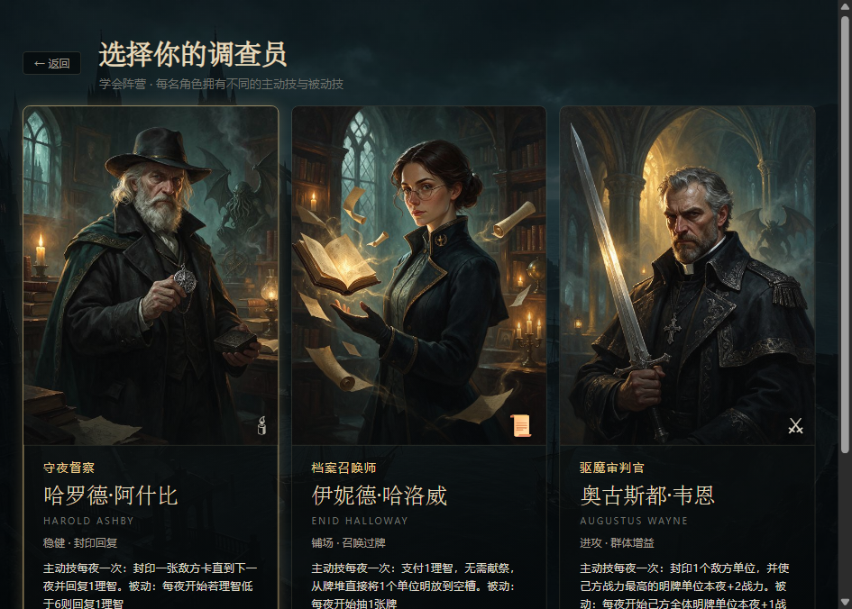
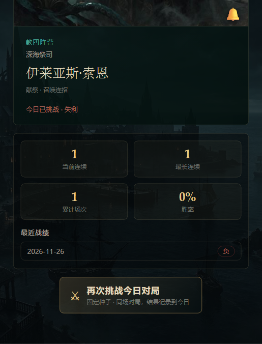
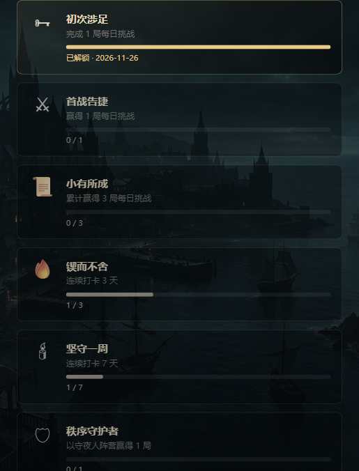
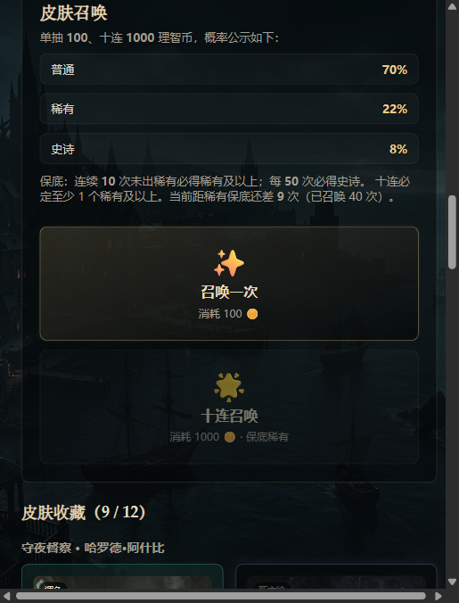
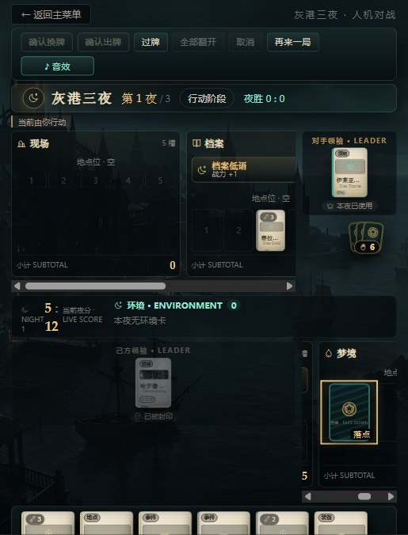
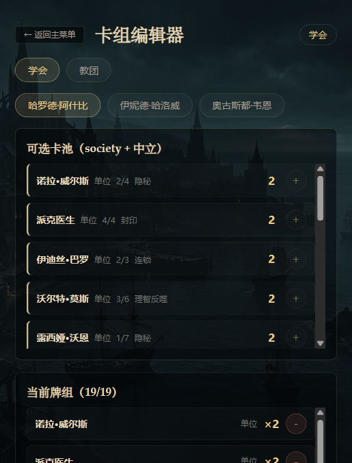
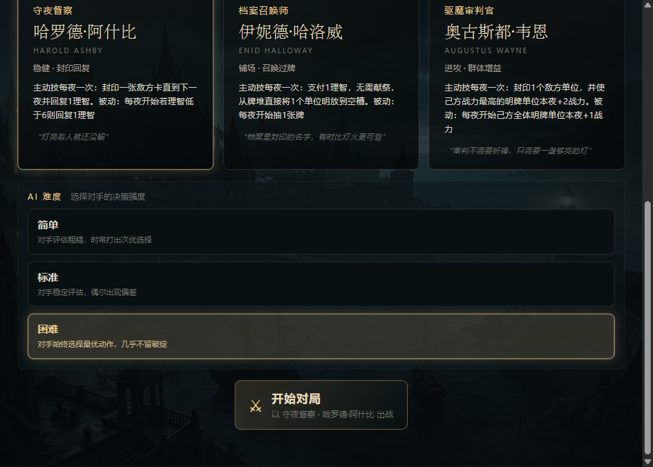

# 灰港三夜 · THREE NIGHTS IN GREYHARBOR

> 原创设定：雾锁的灰港，三夜牌局。学会（Society）与教团（Cult）在灯火与深渊之间轮番落子；
> 理智耗尽者坠入疯狂，先赢两夜者带走港口，而学会追查线索求「真相大白」、教团累积末日召「旧神降临」。
> 双面卡牌在「理 / 狂」之间翻转，封印、腐化、献祭、地点结算与双目标竞速共同构成一套
> **独立于《昆特牌》规则的原创玩法**。

**《灰港三夜》是本项目的新版正式入口（`index.html`）。** 旧版《昆特牌》网页复刻完整保留在
`gwent.html`，作为参考实现与遗留套件，不参与新版规则。

## 设计亮点

- **数据驱动的角色系统**：6 名调查员的主动 / 被动技能全部由效果注册表（`effects/registry.js`）以数据描述，引擎不含 per-id 分支；新增角色只需新增数据，无需改引擎。
- **确定性引擎**：所有随机走注入式 rng（无 `Math.random`），同种子可完全复现，便于复盘、自对弈与锁步防作弊。
- **启发式 AI 对手**：合法动作生成 + 评估函数打分，注入式随机，支持固定种子与随机牌局。
- **竞技场选牌（Arena Draft）**：从随机候选池逐轮三选一构筑 19 张牌，再用该牌进入人机对战；选牌过程确定性、可复现，复用现有引擎与控制器，无 per-id 分支。
- **每日挑战（Daily Challenge）**：把日历日期换算成确定性种子，按日期派生固定阵营与合法领袖，当天所有玩家面对完全相同的一局；结果用本地存档按日期记录，并汇总出当前/最长连续打卡、累计场次、胜率与最近战绩，隐私模式下静默降级。
- **数据驱动成就墙**：成就由数据定义（指标选择器 + 目标值 + 可选前置），从玩家档案纯函数评估，无 per-id 分支、无引擎改动；解锁时间独立存档，成就墙展示进度条与解锁日期。
- **货币 · 商店 · 抽卡经济闭环**：理智币有来源（每日对局/首胜、人机胜利）与消耗（抽卡/购买），抽卡产出纯 CSS 生成、可装备的卡背，概率公示并带稀有/史诗保底；卡背库存与装备状态本地存档，并在对局盖牌上真实渲染，全程数据驱动、无 per-id 分支。
- **卡组编辑器（Deck Builder）**：按阵营自选领袖、从本阵营 + 中立卡池自由加减非领袖卡，受单卡 2 份与 19 张上限约束，实时经 `validateDeck` 校验并按错误码给出中文提示；每阵营一套本地存档，合法后可直接用自建牌组进入人机对局，复用现有引擎、控制器与战斗通道，无 per-id 分支。
- **AI 难度选择（简单 / 标准 / 困难）**：出战前在角色选择屏选择对手的决策强度，难度以数据 profile 描述（犯错概率 + 评分噪声占比），只改变选择层如何把已有动作评分转成决策，不复制整套评估配置；选择经控制器贯穿人机、战役、竞技场、每日与卡组编辑器，并本地持久化，全程无 per-id 分支。
- **锁步对战框架**：可插拔座位驱动 + 确定性输入校验，已用假传输完成两客户端完整对局（菜单入口暂标注“开发中”）。
- **零依赖、零构建**：原生 ES Modules + 本地美术 + WebAudio 实时合成音效，全量 **512 项自动化测试**通过（510 通过 + 2 跳过）。

## 技术栈

- 原生 **ES Modules** + HTML + CSS，**零运行时依赖、零构建步骤、零外部 CDN**。
- 测试只用 Node 内置 `node:test` / `node:assert`，浏览器侧无 jsdom、无 Playwright 运行依赖。
- 引擎确定性：所有随机走注入式 rng，无 `Math.random`；卡面插画、6 张调查员立绘与背景均为本地美术资源（`assets/`，加载失败自动降级为内联 SVG），音效为 WebAudio 实时合成。
- 对局界面为一屏式布局：对手、棋盘、手牌与操作台全部容纳在 `100dvh` 内，无需页面滚动。
- 静态服务器 `server.mjs` 仅用 Node 内置模块；默认监听 `127.0.0.1:8788`。

## 运行与入口

```bat
启动游戏.bat        :: 启动 server.mjs 并打开 http://127.0.0.1:8788/
```

或命令行：

```bash
npm start                        # node server.mjs → http://127.0.0.1:8788/
```

| 地址 | 内容 |
|---|---|
| `/` 或 `/index.html` | **v2 正式入口**：主菜单 → 阵营选择 → 人机对战（含氛围层）、战役 Roguelike、竞技场选牌或每日挑战 |
| `/app.html` | 同款 app shell（阶段 3.3 入口，保留兼容） |
| `/play.html` | 阶段 3.2 人机对战直入（固定种子） |
| `/game.html` | 阶段 3.1 自动棋盘演示 |
| `/gwent.html` | **旧版昆特牌**（原 `index.html`，路径相对引用保持可用） |

> 页面必须通过本地服务器打开（`file://` 下模块与 fetch 会被浏览器拦截）。

## 调查员名册（6 角色 · 立绘卡）

选定阵营后进入角色选择屏：每名调查员是一张**竖版全身立绘 + 文字**的立绘卡（写实油画风，立绘统一 512×683，
卡片按立绘原比例展示完整全身、不裁切），三张竖卡同屏排列、窄屏自动换行，不再一人占一整页；点击切换选中描边并更新出战文案，
确认后以该角色的 `leaderId` 开局。各角色主动技每夜一次、被动多在每夜开始触发，规则全部数据化
（见 `src/ui-v2/menu/templates/character-select.mjs` 与 `effects/registry.js`）。

**学会 Society**

| 角色（称号） | 定位 | 主动技 | 被动 |
|---|---|---|---|
| 🕯 哈罗德·阿什比（守夜督察） | 稳健 · 封印回复 | 封印一张敌方卡直到下一夜并回复 1 理智 | 每夜开始若理智低于 6 则回复 1 理智 |
| 📜 伊妮德·哈洛威（档案召唤师） | 铺场 · 召唤过牌 | 支付 1 理智，无需献祭，从牌堆直接将 1 个单位明放到空槽 | 每夜开始抽 1 张牌 |
| ⚔ 奥古斯都·韦恩（驱魔审判官） | 进攻 · 群体增益 | 封印 1 个敌方单位，并使己方战力最高的明牌单位本夜 +2 战力 | 每夜开始己方全体明牌单位本夜 +1 战力 |

**教团 Cult**

| 角色（称号） | 定位 | 主动技 | 被动 |
|---|---|---|---|
| 🔔 伊莱亚斯·索恩（深海祭司） | 献祭 · 召唤连招 | 献祭一张己方卡，从牌堆直接打出一个异怪单位 | 每夜首次献祭触发额外回响 |
| 🚪 薇拉·克洛（唤灵者） | 空降 · 风险召唤 | 无需献祭，从牌堆召唤 1 个异怪单位明放，但该异怪获得 1 腐化 | 每夜开始若理智不超过 3 则抽 1 张牌 |
| ☣ 格里高尔·瘟钟（腐化使徒） | 压制 · 腐化削弱 | 使 1 个敌方明牌单位获得 2 腐化 | 每夜开始敌方全体明牌单位本夜 −1 战力 |



## 目录地图

```
index.html / app.html / play.html / game.html / gwent.html
server.mjs · 启动游戏.bat · README.md · LICENSE
assets/
├─ art/             卡面插画与 6 张调查员立绘（JPG，按 card-id 命名，统一 512×683）
└─ bg/              页面背景图
src/
├─ engine/v2/       新版规则引擎：确定性状态机、效果 DSL、buildView、计分、anomalies、chaos-bag、objectives
├─ ai/v2/           新版 AI（合法动作 + 启发式评估，数据驱动难度 profile，注入式随机）
├─ campaign/        战役元层：地图、池、操作 DSL、奖励、战斗翻译、run 状态机 + data/（遗物、事件）
├─ arena/           竞技场选牌纯逻辑（候选池 / 三选一 / 份数 / 校验 / battleOptions）
├─ daily/           每日挑战纯逻辑（日期→种子 / 阵营 / 领袖 / battleOptions / 记录读写 / 连续与胜率统计）
├─ achievements/    成就引擎（档案构建 / 数据化成就目录 / 评估 / 解锁同步 / 成就墙组装）
├─ economy/         经济系统（卡背目录 / 钱包 / 抽卡概率与保底 / 库存与装备）
├─ deck/            卡组编辑器纯逻辑（编辑器状态与规则 / 本地存档 / 出战 battleOptions）
├─ data/            卡表 / 领袖 / 阵营 / 预设牌组（唯一数值事实源）
├─ ui-v2/           新版 UI
│  ├─ campaign/     战役控制器 + 纯函数屏幕模板（地图 / 事件 / 奖励 / 休整 / 结算）
│  ├─ arena/        竞技场选牌控制器 + 纯函数模板
│  ├─ daily/        每日挑战控制器 + 纯函数模板
│  ├─ achievements/ 成就墙控制器 + 纯函数模板
│  ├─ shop/         商店控制器 + 抽卡/卡背纯函数模板
│  ├─ deck/         卡组编辑器控制器 + 纯函数模板
│  ├─ menu/         app shell、菜单 / 阵营 / 结果模板
│  ├─ storage.mjs   通用本地存档封装（注入式后端，默认 localStorage，静默降级）
│  ├─ templates/    纯字符串模板（data-uid / data-card-id / data-faction）
│  ├─ fx/           view-diff、DOM 动画、粒子池、fx-controller
│  ├─ audio/        WebAudio 合成引擎与事件→音色映射
│  └─ shims/        浏览器侧 node:fs 兼容层
├─ styles-v2/       theme / card / board / layout / interaction / menu / screens / fx / campaign
├─ engine/, ai/, ui/, styles/   旧版昆特牌参考实现（保留，勿改）
└─ app.js / main.js 旧版入口（由 gwent.html 加载）
tests/
├─ campaign/        战役套件（地图 / 数据 / run 状态机 / 战斗配置 / 操作 / 模板，53 项）
├─ arena/           竞技场选牌纯逻辑套件（11 项）
├─ daily/           每日挑战纯逻辑 + 统计套件（15 项）
├─ achievements/    成就引擎纯逻辑套件（7 项）
├─ economy/         经济系统套件（钱包 / 抽卡 / 保底 / 装备，11 项）
├─ deck/            卡组编辑器纯逻辑套件（15 项）
├─ v2/, ai-v2/      新版引擎 / AI 套件（含难度选择，9 项）
├─ ui-v2/           新版 UI、控制器、氛围层、存档、各模式模板套件（含商店、卡组编辑器，注入假对象）
└─ *.test.mjs       旧版引擎 / 数据 / AI / E2E 遗留套件
scripts/            自对弈、实验台、消融、E2E 等工具（零外部依赖）
docs/               规则、架构、美术方向、平衡实验报告
research/           来源数据、QA 记录与审计产物
```

## 操作

- 主菜单选择「开始对局」→ 阵营 + 固定/随机种子 → 进入对局。
- 主菜单选择「战役模式」→ 阵营 → 地图上点击发光的可达节点推进，战斗/事件/休整/宝藏依次进行，抵达并击败 Boss 即通关。
- 点击手牌 → 点击高亮落点出牌；可点击己方领袖、盖牌翻开、过牌；`Esc` 取消。
- 换牌阶段点击手牌标记，再点「确认换牌」。教团领袖伊莱亚斯会打开步骤式编排弹层。
- 操作台「♪ 音效 / ♪ 已静音」按钮切换声音；设置存 `localStorage`，首次用户手势才解锁音频。
- `prefers-reduced-motion: reduce` 时粒子关闭、翻面/脉冲降级为瞬时淡入；静音按钮可完全关闭声音。

## v1.3 新机制（动态地点 · 混沌袋 · 发掘）

规则事实源：`docs/EXPANSION_V1_DESIGN.md`。旧规则全部保留，三个机制均为增量，且可通过
`createGame({ mechanics: { anomaly, chaosBag } })` 单独开关。

1. **动态地点（地点异变）**：每夜开始随机抽取 1 个异变（共 12 个），作用于某一地点列或全局，
   提供战力修正、入场腐化/理智、免疫封印、领袖禁入、环境禁用等单一效果，让每夜的地点价值不同。
2. **混沌袋检定**：6 类共 19 枚代币（抽后放回）。明放单位入场、盖牌翻开时各抽 1 枚，按代币
   修正该实例战力（期望修正 ≈ 0，只增加波动）。平衡定稿移除了旧神之印原本的 −1 理智，仅保留 −3 战力。
3. **发掘（Discover）**：芬恩·卡洛威（出牌时）与露西娅·沃恩（翻开时）查看牌堆顶 3 张，选 1 张入手，
   其余原序放回；空牌堆为 no-op。玩家通过选择弹窗三选一，AI 按评估价值自动选择。

每个新机制都同步更新了 AI 启发式（`src/ai/v2/config.mjs`、`evaluate.mjs`）并新增专项测试
（`tests/v2/mechanics-v13.test.mjs`）。`scripts/balance-v13-ablation.mjs` 用机制开关做消融，
定稿 2000 局双向胜率 49.6–50.4%、理智结束占比 33–34%（与 v1.2 一致）、0 崩溃、牌数守恒。

## v1.4 双目标（线索 · 末日）

规则事实源：`docs/EXPANSION_V2_OBJECTIVES_DESIGN.md`。在「三夜两胜 / 理智归零」之外新增第三条
胜利路径，且两个阵营的目标类型与达成方式真正分化；可通过 `createGame({ mechanics: { objectives } })`
单独开关，与 v1.3 机制正交。

1. **学会 · 线索（Clue）**：己方单位明放进入档案列、以及夜结算时档案列战力严格高于对手，各积累线索。
2. **教团 · 末日（Doom）**：打出仪式卡（降灵会 / 潮汐仪式）、以及己方单位因献祭真正进入深渊（含吞噬），
   各积累末日。
3. 目标进度只增不减、全程公开，达到阈值（**定稿 7**）立即获胜，胜利原因 `reason='objective'`；
   学会结局「真相大白」、教团结局「旧神降临」。理智归零的判定始终优先于目标胜利。

玩家栏新增目标进度轨（`templates/objective.mjs`，线索古金 / 末日暗红菱形 pips，窄屏随玩家栏自适应隐藏），
结果面板按阵营显示对应结局文案，fx 层在增益时施加脉冲（`prefers-reduced-motion` 下降级）。AI 评估新增
目标竞速评分（`config.mjs`、`evaluate.mjs`），并在模拟出牌/献祭时同步进度。专项测试
`tests/v2/objectives-v14.test.mjs`（13 项）。阈值扫描显示存在明显悬崖（5→85.8%、7→31.5%、8→4.5% 的
目标结束占比），定稿阈值 7；`scripts/balance-objectives-final.mjs` 同种子 6400 局复核：交叉胜率
46.95–53.05%、目标结束约 28.5%、理智约 27%、夜胜约 44%，0 崩溃、牌数守恒。

## 战役 v3（Roguelike 调查之旅）

规则事实源：`docs/CAMPAIGN_V3_DESIGN.md`。把单局牌局串成一次可重复的调查：从起点沿分层 DAG
地图推进，经 7 层抵达 Boss，节点之间让牌组与遗物成长。整段 run 完全确定性（固定 seed 可复现），
不引入商店、卡牌升级、跨 run 元进度或新卡牌。

1. **六类节点**：普通战斗 `battle`、精英 `elite`、叙事事件 `event`、休整 `rest`、宝藏 `treasure`、
   终点 `boss`。事件为带条件分支的叙事选择；休整可领物资或移除一张卡；宝藏给遗物。
2. **成长**：战斗胜利后从牌堆池三选一加卡（精英额外给遗物），遗物提供单局或 run 层被动（共 8 件）；
   单一货币 `supplies` 贯穿，奖励与事件均经结构化操作 DSL 落库。
3. **难度梯度（不新增规则）**：精英/Boss 用 `createGame` 既有配置制造压力——起手手牌 8/7/6、
   起始理智 6/5/4。为此引擎把 `startingHand` 与 `startingSanity` 对齐为支持双玩家数组的配置泛化。
   受控校准（固定基线牌组、同种子、只变节点类型，300 组/类型，固化于 `docs/campaign-final-check.json`）：

   | 节点 | 学会 Society | 教团 Cult |
   | --- | --- | --- |
   | 普通 battle | 50.67% | 49.33% |
   | 精英 elite | 40.00% | 29.00% |
   | Boss | 30.67% | 16.33% |

   普通战斗接近公平、精英/Boss 逐级加难且仍可通关；该数据为无成长基线口径，真实 run 中加卡与遗物会抬高实际胜率。

战役元层位于 `src/campaign/`（地图、池、操作、奖励、战斗翻译、run 状态机及数据），交互界面位于
`src/ui-v2/campaign/`（控制器 + 纯函数模板），样式 `src/styles-v2/campaign.css`。专项测试
`tests/campaign/`（53 项）。`scripts/campaign-soak.mjs` 做全 run 浸泡（0 崩溃、状态守恒），
`scripts/campaign-balance.mjs` 做受控难度校准、`campaign-balance-final.mjs` 出定稿数据。

## 竞技场选牌（Arena Draft）

主菜单「竞技场选牌」进入。先选阵营与调查员（领袖），再从随机候选池逐轮**三选一**，构筑一副
19 张非领袖牌后用该牌进入人机对战。整套玩法数据驱动、复用现有确定性引擎与启发式 AI，不新增
引擎规则、不含 per-id 分支。


1. **候选池**：本阵营 11 张非领袖卡 + 6 张中立卡 = 17 张；每轮随机出 3 张互不相同的候选，
   单卡最多 2 份，达到上限的卡不再进入候选。
2. **确定性**：每轮 RNG 由「种子 + 轮次」派生，渲染不推进随机状态；同种子、同选择序列必然得到
   相同候选与牌组。每次进入竞技场生成一颗新种子（浏览器用 `crypto.randomUUID`）。
3. **合法性**：选满 19 张后用 `validateDeck` 校验（阵营/中立、份数、张数、领袖合规），再翻译成
   `createGame` 的 `battleOptions`——人类为构筑牌、对手为另一阵营预设牌——经控制器既有的
   `battleOptions` 注入点开打，驱动循环、AI 与结算面板完全不变。

纯逻辑位于 `src/arena/draft.mjs`（候选池、每轮 offer、份数、牌组与 battleOptions 构建），交互界面
位于 `src/ui-v2/arena/`（控制器 + 纯函数模板），样式见 `src/styles-v2/menu.css` 的 Arena Draft 段。
专项测试 `tests/arena/draft.test.mjs`（11 项）与 `tests/ui-v2/arena-template.test.mjs`（6 项），
含 headless 整局打完与 HTML 转义验收。

## 每日挑战（Daily Challenge）

主菜单「每日挑战」进入。无需选择阵营与角色：系统把**当天日期**换算成确定性种子，并按日期派生
固定阵营与该阵营的合法领袖，当天所有玩家面对完全相同的一局预设牌对局。结束后用本地存档按日期
记录胜负，重进介绍屏会显示「今日已挑战 · 胜利 / 失利」，并在下方看到连续打卡、胜率与最近战绩，
也可再次挑战同一固定对局。



1. **日期 → 种子**：本地时区格式化为 `YYYY-MM-DD`，种子为 `greyharbor-daily-YYYY-MM-DD`；对日期
   字符串做 FNV-1a 哈希，用哈希选阵营、再从该阵营的稳定领袖列表中选领袖，全程无 `Math.random`。
2. **确定性**：同一日期任意时刻、任意玩家得到的阵营、领袖、牌组与对局完全一致；不同日期自然轮换。
3. **复用引擎**：把日期配置翻译成 `createGame` 的 `battleOptions`（座位 0 为人类阵营 + 当日领袖，
   座位 1 为对立阵营预设牌），经控制器既有的 `battleOptions` 注入点开打，驱动循环、AI 与结算面板不变。
4. **本地存档**：通用存档封装 `src/ui-v2/storage.mjs`（默认 localStorage，可注入后端），每日记录写在
   `greyharbor.daily.challenge.v1` 下的按日期 map；隐私模式 / 配额受限时 try/catch 静默降级，坏 JSON 容错，
   不阻断游玩。
5. **打卡与战绩**：纯函数 `src/daily/stats.mjs` 从按日期 map 汇总**当前连续 / 最长连续**（当天未打不中断，
   缺一天即断）、累计场次、胜场与胜率，以及最近 10 天的胜负列表；日期运算走 UTC，避免时区与夏令时漂移。

纯逻辑位于 `src/daily/daily.mjs`（日期格式化、配置派生、battleOptions 构建、记录读写）与
`src/daily/stats.mjs`（连续、胜率、最近战绩汇总），交互界面位于
`src/ui-v2/daily/`（控制器 + 纯函数模板），通用存档见 `src/ui-v2/storage.mjs`，样式见
`src/styles-v2/menu.css` 的 Daily Challenge 段。专项测试 `tests/daily/daily.test.mjs`（8 项）、
`tests/daily/stats.test.mjs`（7 项）、`tests/ui-v2/storage.test.mjs`（5 项）与
`tests/ui-v2/daily-template.test.mjs`（5 项），
含 headless 整局打完、连续打卡边界、坏记录容错与 HTML 转义验收。

## 成就墙（Achievements）

主菜单「成就墙」进入。打开时把玩家档案（由每日记录归一化得到）喂给一组**纯数据成就**，逐项评估
并把新满足的成就写入独立存档（记录解锁时间），再渲染成带进度条的卡片网格：已解锁高亮并显示解锁
日期，未解锁显示当前进度或前置提示。



1. **数据驱动，无 per-id 分支**：每个成就形如 `{id, name, description, icon, target, metric(profile)}`，
   统一规则为 `metric(profile) >= target`；需要前置条件时加可选 `gate`（如“先完成 5 局”）。新增成就
   只需追加一条数据，评估与渲染逻辑不变。
2. **档案复用现有数据**：档案由每日记录构建（总场次、胜负、胜率、当前/最长连续、按阵营胜场），
   阵营胜场通过日期配置反查，不新增对局埋点、不改引擎。
3. **纯函数 + 可注入时钟**：评估是确定性纯函数，解锁时间戳经注入的时钟产生，便于测试；重复同步不会
   覆盖已有的解锁时间，也不会产生多余写盘。存档不可用时静默降级，不阻断游玩。

核心逻辑位于 `src/achievements/achievements.mjs`（档案构建、成就目录、评估、解锁同步、成就墙组装），
交互界面位于 `src/ui-v2/achievements/`（控制器 + 纯函数模板），样式见 `src/styles-v2/menu.css` 的
Achievement wall 段。专项测试 `tests/achievements/achievements.test.mjs`（7 项）与
`tests/ui-v2/achievements-template.test.mjs`（5 项），
含前置门控、解锁时间不覆盖、坏存档容错与 HTML 转义验收。

## 货币 · 商店 · 抽卡（Economy）

主菜单「神秘商店」进入。游戏内货币为**理智币**，构成完整的 source + sink 闭环，且全部为外观收集，
不影响任何对局平衡。



**货币来源（source）**

1. 每日挑战：完成一局（无论胜负）得 40 理智币；当天首次获胜额外得 120 理智币，均按日期幂等发放，重复对局不重复领取。
2. 人机对局：在人机对战 / 竞技场 / 战役中获胜，每胜一局得 25 理智币。

**货币消耗（sink）**

- 卡背召唤：单次抽取消耗 100 理智币，从卡背池中随机产出一款卡背。
- 概率公示：普通 70% / 稀有 22% / 史诗 8%；连续 10 次未出稀有必得稀有及以上，每 50 次必得史诗。
- 抽到已拥有的卡背时自动按稀有度返还理智币（普通 10 / 稀有 30 / 史诗 60），不会空手而归。

**卡背：纯 CSS 数据驱动，无新增美术**

- 卡背目录是一组数据 `{id, name, rarity, icon, description}`，外观由对应 `.gh2-card--back-<id>` 的 CSS 渐变/纹章规则生成，不新增任何图片资源。
- 卡背库存与装备状态写入独立本地存档；在商店点击「装备」后，己方在对局中暗放（盖牌入场）的卡牌会真实渲染该卡背，对手盖牌仍保持默认卡背。



核心逻辑位于 `src/economy/`（`card-backs.mjs` 卡背目录、`economy.mjs` 钱包/抽卡/保底/装备），
交互界面位于 `src/ui-v2/shop/`（控制器 + 纯函数模板），卡背经 `renderCardBack` 的 `cardBackId`
透传到棋盘，样式见 `src/styles-v2/card.css`（卡背外观）与 `menu.css`（商店界面）。
专项测试 `tests/economy/economy.test.mjs`（11 项）与 `tests/ui-v2/shop-template.test.mjs`（6 项），
覆盖幂等发放、概率与保底、重复返还、装备校验、坏存档容错、HTML 转义与盖牌透传。

## 卡组编辑器（Deck Builder）

主菜单「卡组编辑器」进入。编辑器完全数据驱动，规则与对局共用同一套 `DECK_RULES` 与 `validateDeck`：

- **阵营与领袖**：在学会 / 教团间切换，各自从本阵营 3 名领袖中选择 1 名；切换阵营会载入该阵营已保存的牌组，没有则开新牌组。
- **自由加减卡**：卡池为「本阵营 + 中立」的非领袖卡（每阵营 17 张），可逐张加入或移除；单张卡最多 2 份、非领袖卡总数恰好 19 张，达到上限时加卡按钮自动禁用。
- **实时校验**：每次变更都经 `validateDeck` 校验，按错误码映射为中文提示（含涉及的卡名），并展示类型统计与 `n/19` 进度；只有合法牌组才能出战。
- **本地存档**：每阵营一套，写入独立存档键 `greyharbor.custom-decks.v1`，刷新后依旧保留，坏 JSON 容错。
- **直接出战**：合法牌组经 `buildDeckBattleOptions` 转成 `createGame` 选项，己方用自建牌组、对手用对立阵营预设，走通用 `mountBattleOptions` 通道，驱动循环、AI 与结算面板完全复用。



纯逻辑在 `src/deck/`（`editor.mjs` 状态与规则、`decks-store.mjs` 存档、`battle.mjs` 出战选项），
交互界面位于 `src/ui-v2/deck/`（控制器 + 纯函数模板），样式见 `src/styles-v2/menu.css`。
专项测试 `tests/deck/editor.test.mjs`（15 项）与 `tests/ui-v2/deck-template.test.mjs`（6 项），
覆盖池/领袖资格、加减卡、份数与 19 张上限、阵营/领袖切换、存档往返与坏 JSON、出战选项形状，以及用自建牌组由 AI 打完一整局。

## AI 难度选择（简单 · 标准 · 困难）

出战前在角色选择屏选择对手的决策强度，三档完全由数据 profile 描述，不复制整套启发式配置：

| 难度 | 犯错概率 | 评分噪声 | 行为表现 |
|---|---|---|---|
| 简单 | 0.40 | 0.55 | 评估粗糙，时常打出次优选择 |
| 标准 | 0 | 0.12 | 稳定评估，偶尔出现偏差 |
| 困难 | 0 | 0 | 始终选择最优动作，几乎不留破绽 |

- **只改选择层**：`chooseAction` 先用同一套 `evaluate` 给所有合法动作打分，再按 profile 决定结果——犯错时从全部合法动作中均匀抽取，否则在每个动作评分上叠加「评分极差 × 噪声占比」的注入式随机抖动后取最优；噪声为 0 时退化为严格最优、并列由 RNG 裁决。
- **贯穿各模式**：所选档位经 `game-controller` 透传，人机、战役、竞技场、每日挑战与卡组编辑器全部生效；未指定难度的旧调用保持严格最优，行为不变。
- **本地持久化**：写入独立存档键 `greyharbor.ai-difficulty.v1`，刷新后保留，坏值回退标准档，隐私模式静默降级。



核心逻辑在 `src/ai/v2/difficulty.mjs`（profile 目录、解析器、存档读写），选择层接入 `src/ai/v2/ai.mjs`，
交互界面位于角色选择模板与 `app-shell`，样式见 `src/styles-v2/menu.css`。
专项测试 `tests/ai-v2/difficulty.test.mjs`（9 项），覆盖 profile 数据与排序、解析与降级、困难/旧调用严格最优、简单偏离与合法、可复现性、换牌不受影响及存档往返。

## 氛围层（阶段 3.4）

- `fx/view-diff.mjs` 纯函数比较前后 `buildView`：入场 uid、理↔狂翻面、理智变化、新封印/腐化、夜切换、终局。
- `fx/dom-animations.mjs` 只加临时 CSS 类，带超时清理与异常兜底，不阻塞交互。
- `fx/particles.mjs` 单 rAF + ≤300 固定粒子池的全屏 canvas；页面隐藏暂停，禁用时零发射，确定性 rng。
- `fx/fx-controller.mjs` 经 `hooks.afterPaint` / `hooks.onEvents` 接入控制器，不写游戏状态。
- `audio/audio-engine.mjs` 零音频资源、主音量/静音、首次手势 unlock、峰值压缩；`audio/sound-map.mjs` 纯映射事件→音色。

## 测试

```bash
npm test                                            # 根目录套件：104 通过 / 2 E2E 默认跳过（共 106）
node --test tests/campaign/*.test.mjs               # 战役套件：53 项
node --test tests/v2/*.test.mjs                     # 引擎套件：130 项
node --test tests/ai-v2/*.test.mjs                  # AI 套件：7 项
node --test tests/ui-v2/*.test.mjs                  # UI + 氛围层 + 角色选择 + 各模式模板 + 存档：109 项
node --test tests/arena/*.test.mjs                  # 竞技场选牌纯逻辑：11 项
node --test tests/daily/*.test.mjs                  # 每日挑战纯逻辑 + 统计：15 项
node --test tests/achievements/*.test.mjs           # 成就引擎纯逻辑：7 项
node --test tests/economy/*.test.mjs                # 经济系统（钱包/抽卡/保底/装备）：11 项
node --test tests/deck/*.test.mjs                   # 卡组编辑器纯逻辑：15 项
node --test tests/multiplayer/*.test.mjs            # 锁步 / 多人框架：11 项
node --test tests/tutorial/*.test.mjs               # 交互式教程：14 项
node --test tests/ai-v2/difficulty.test.mjs         # AI 难度选择：9 项
node --test                                         # 全量递归：512 项 = 510 通过 + 2 跳过，0 失败
```

`npm test` 的脚本只匹配 `tests/*.test.mjs`；子目录套件需按上面的显式 glob 运行。
在 Windows PowerShell 中，npm 脚本里的单引号 glob 可能被原样传给 Node（导致匹配 0 项）；
此时请直接运行不带引号的 `node --test tests/*.test.mjs` 或上面的全量命令。
氛围层测试全部使用可注入的假 DOM / 假 AudioContext / 假调度器，不引入外部依赖。

## 数据驱动的平衡方法

平衡不靠拍脑袋：先用脚本采集，再消融定位，最后用同种子大样本复核。

1. **诊断 / 实验台**：`scripts/balance-diagnose.mjs`、`scripts/balance-experiment.mjs` 采集镜像对局、
   交叉基线、逐卡打出率与入场有效战力（例：`--games=1000 --seed=balance-v1.2`）。
2. **消融**：`scripts/balance-ablation.mjs` 把目标卡替换为同类型空白卡、或把阵营被动置 0，
   同种子重打，用 `Δpp` 量化单卡/被动的真实贡献。
3. **候选矩阵**：`scripts/balance-candidates.mjs` 同时跑 crossAB / crossBA / 两个镜像方向，
   避免只调一个座位导致假平衡。
4. **定稿口径**：`scripts/balance-final-check.mjs` 用 shipped defaults 跑 **同种子 2000 局**，
   要求双方胜率落入 45–55%、镜像接近 50%、理智结束占比 ≥10%、卡牌/实例守恒 ok，且既有测试全绿。
5. 实验期数值通过临时 `cardOverrides` / `ruleOverrides` 注入；定稿后钩子移除，数值只存在于
   `src/data/card-table.normalized.json` 与引擎常量（单一事实源）。详见 `docs/BALANCE_PATCH_V1.1.md` /
   `docs/BALANCE_PATCH_V1.2.md` 与 `docs/v12-*.json`。

氛围层（阶段 3.4）**未改动** `src/engine`、`src/ai`、`src/data`、卡面数值与规则，只读 `buildView` 与事件流；
其后的 v1.3 在引擎与 AI 上增量接入三个新机制，v1.4 再增量加入线索/末日双目标（均见上节）。

## 来源致谢与许可

- 旧版 `gwent.html` 及其引擎/UI/测试源自社区项目 **gwent-web**（原仓库入口 `index.html`），
  用于复刻《巫师 3：狂猎》昆特牌的规则研究与参考实现。感谢该项目与相关社区数据整理者。
- 《巫师》系列、昆特牌的商标、角色与卡牌名称版权归 **CD PROJEKT RED** 所有；本项目为
  **非官方粉丝作品**，与官方无关联，不含官方美术/音频资源。
- 新版《灰港三夜》的规则、设定、文案、卡面程序化图形与音效均为本项目原创实现。
- 代码以 [MIT License](LICENSE) 开源（Copyright © 2026 William XIAO）；第三方参考数据的
  原始副本位于 `research/`，仅作审计与溯源用途。

## 已知限制

- 正式可玩内容为单机对 AI；联机仅有确定性锁步框架与测试（菜单入口标注“开发中”），没有账号或战绩系统。
- AI 是启发式评估，不做深度搜索。
- 浏览器自动播放策略要求首次点击/按键后才会有声音；`file://` 直接打开不可用。
- 粒子仅用于四类关键反馈（理智归零 / 腐化 / 封印 / 出牌），非全屏天气系统。
